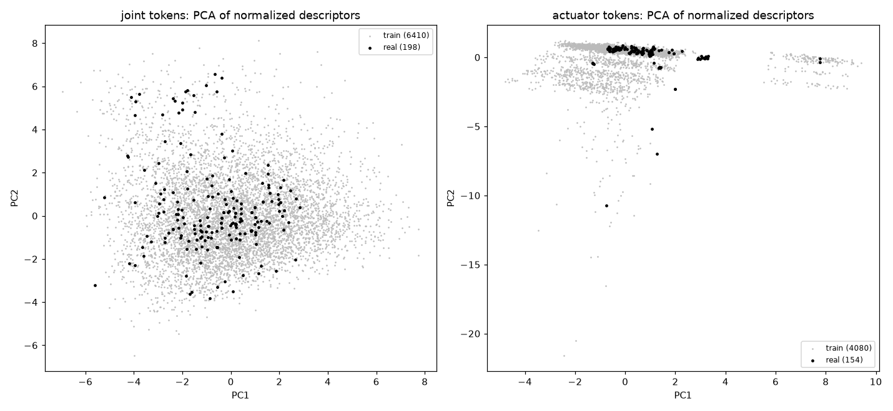

# Descriptor report (genhand-1k-v4)

Generated by `scripts/descriptor_report.py`. Normalizer fitted on the train split (676 hands, 6410 joint tokens, 4080 actuator tokens); statistics in `registry/descriptor_stats_genhand-1k-v4.json`.

## Token-level support

Score = mean over a hand's tokens of the distance (normalized descriptor space) to the nearest train token of another hand. Reference: the same score for each train hand, leave-one-hand-out (joint p99 3.66, actuator p99 3.31). Out of support = above p99 for joints or actuators.

| split | hands | out of support | joint score median | actuator score median |
|---|---|---|---|---|
| test_id | 75 | 0 (0%) | 2.13 | 1.36 |
| test_ood_topology | 83 | 1 (1%) | 2.12 | 1.46 |
| test_ood_scale | 131 | 12 (9%) | 2.47 | 1.54 |
| real | 17 | 8 | 3.56 | 1.62 |

| real hand | joints | actuators | joint score (pct) | actuator score (pct) | out of support | flags |
|---|---|---|---|---|---|---|
| jaxon_right | 2 | 2 | 5.16 (100) | 2.23 (92) | **yes** | - |
| jvrc1_right | 6 | 1 | 5.84 (100) | 2.58 (97) | **yes** | - |
| leap_right | 16 | 16 | 5.24 (100) | 1.92 (83) | **yes** | - |
| r2_right | 18 | 18 | 8.72 (100) | 1.53 (60) | **yes** | - |
| romeo_right | 13 | 1 | 4.76 (100) | 2.35 (94) | **yes** | - |
| talos_right | 7 | 1 | 4.45 (100) | 2.20 (91) | **yes** | - |
| allegro_right | 16 | 16 | 4.34 (100) | 1.45 (53) | **yes** | - |
| g1_dex3_1_right | 7 | 7 | 4.01 (99) | 1.62 (66) | **yes** | - |
| g1_dex1_1 | 2 | 2 | 3.52 (99) | 1.15 (20) | no | - |
| unitree_dex5_1_right | 20 | 20 | 3.56 (99) | 1.21 (27) | no | - |
| valkyrie_right | 13 | 13 | 3.51 (99) | 1.96 (84) | no | - |
| icub_mk3_left | 11 | 11 | 3.44 (98) | 1.19 (24) | no | - |
| h1_2_inspire_ftp_right | 12 | 6 | 3.24 (97) | 2.47 (96) | no | - |
| h1_inspire_dfq_right | 12 | 6 | 3.24 (97) | 2.47 (96) | no | - |
| shadow_right | 22 | 18 | 3.12 (96) | 1.51 (58) | no | - |
| g1_brainco_right | 11 | 6 | 3.08 (95) | 1.43 (52) | no | - |
| unitree_dex2_5_right | 10 | 10 | 2.62 (82) | 1.05 (12) | no | - |

## Per-field coverage of real-hand tokens

Share of real tokens outside the train tokens' 1st-99th percentile, per field (fields above 10% listed).

- joint tokens (198 real): `base_pos_z` 26%, `tip_vec_x` 22%, `tip_pos_x` 22%, `axis_z` 16%, `pos_z` 15%, `tip_pos_z` 15%, `lo` 13%, `link_mass` 13%, `range` 12%, `hi` 11%
- actuator tokens (154 real): `driven_pos_z` 16%

