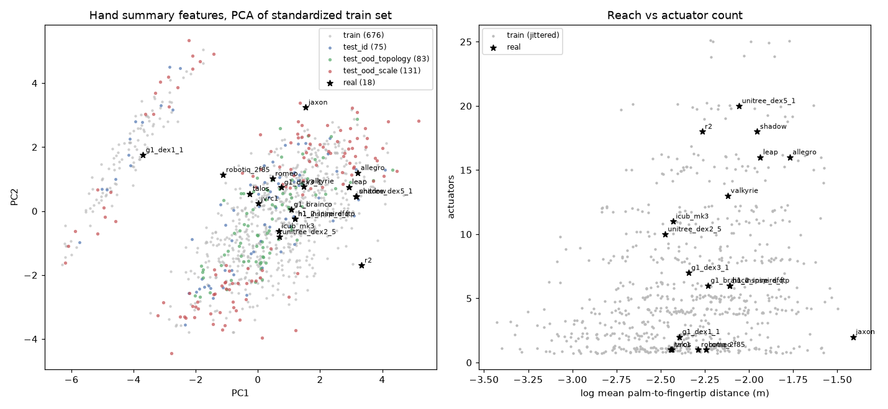
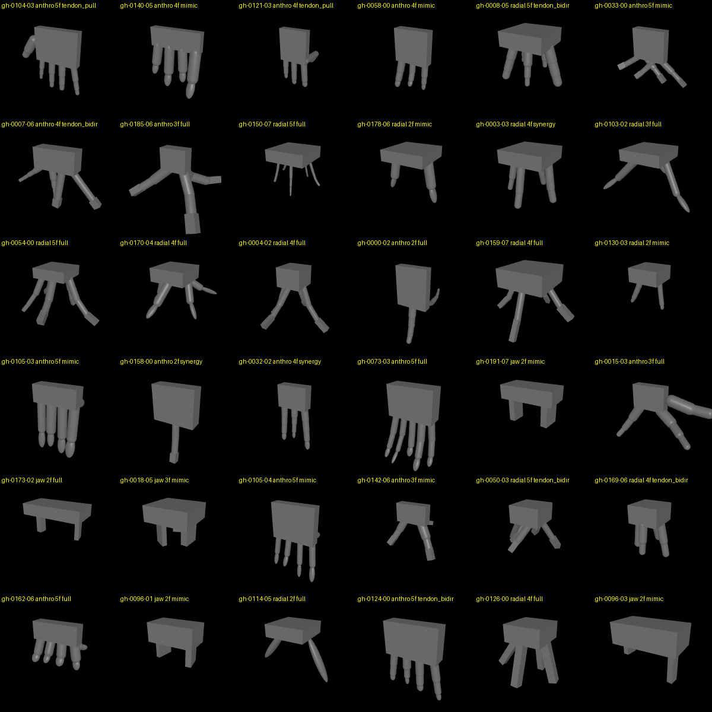

# genhand-1k-v4 report

Generated by `scripts/gen_genhand.py` (generator v4, seed 0, 200 topology draws x 8 variants, git `511097cc14`).

## Validity filter

- **965 / 1600 valid (60.3%), rejection rate 39.7%**
- Filter: no self-penetration (> 1 mm, non-adjacent links) at rest and at the open pose; scripted close-and-lift lifts >= 2 of 6 reference objects (box, cylinder, sphere at half-extents 12, 25 mm).

| reason | hands |
|---|---|
| valid | 965 |
| grasp | 527 |
| self_penetration_open | 108 |

Reference objects lifted, per hand that reached the grasp test:

| lifted | hands |
|---|---|
| 0 | 375 |
| 1 | 152 |
| 2 | 152 |
| 3 | 223 |
| 4 | 128 |
| 5 | 121 |
| 6 | 341 |

Rejection by `layout`:

| value | valid | rejected | rate |
|---|---|---|---|
| anthro | 519 | 601 | 54% |
| jaw | 136 | 0 | 0% |
| radial | 310 | 34 | 10% |

Rejection by `thumb`:

| value | valid | rejected | rate |
|---|---|---|---|
| - | 136 | 0 | 0% |
| coplanar | 113 | 239 | 68% |
| none | 387 | 157 | 29% |
| opposed | 329 | 239 | 42% |

Rejection by `coupling`:

| value | valid | rejected | rate |
|---|---|---|---|
| full | 455 | 289 | 39% |
| mimic | 233 | 111 | 32% |
| synergy | 131 | 165 | 56% |
| tendon_bidir | 104 | 56 | 35% |
| tendon_pull | 42 | 14 | 25% |

Rejection by `n_fingers`:

| value | valid | rejected | rate |
|---|---|---|---|
| 2 | 241 | 103 | 30% |
| 3 | 217 | 191 | 47% |
| 4 | 273 | 151 | 36% |
| 5 | 234 | 190 | 45% |

Rejection by `n_phalanges`:

| value | valid | rejected | rate |
|---|---|---|---|
| - | 136 | 0 | 0% |
| 1 | 93 | 139 | 60% |
| 2 | 261 | 131 | 33% |
| 3 | 306 | 246 | 45% |
| 4 | 169 | 119 | 41% |

Rejection by `tip`:

| value | valid | rejected | rate |
|---|---|---|---|
| - | 136 | 0 | 0% |
| box | 292 | 212 | 42% |
| capsule | 223 | 209 | 48% |
| pad | 314 | 214 | 41% |

Rejection by `abduction`:

| value | valid | rejected | rate |
|---|---|---|---|
| - | 136 | 0 | 0% |
| all | 147 | 213 | 59% |
| none | 617 | 359 | 37% |
| thumb | 65 | 63 | 49% |

## Splits

| split | hands |
|---|---|
| train | 676 |
| rejected | 635 |
| test_ood_scale | 131 |
| test_ood_topology | 83 |
| test_id | 75 |

Scaling subsets (nested prefixes of a seeded permutation of train): 8: 8, 32: 32, 128: 128, 512: 512, all: 676

Topology classes with a valid hand: 166; valid hands per class: median 5, max 40; classes whose variants differ in self-collision pair count: 109.

## Coverage: real hands vs the procedural cloud

Hand-level summary vector (`n_fingers`, `n_joints`, `n_actuators`, `act_per_joint`, `frac_slide`, `log_span`, `log_reach`, `log_closure`, `log_mass`, `hinge_range`, `log_force`, `log_aperture`), standardized by train statistics. Nearest-neighbour distance from each real hand to the train set, compared with leave-one-out train -> train (median 1.01, p95 1.55, p99 1.82, max 2.82). PCA: first two components explain 63% of the train variance.

| real hand | NN distance | percentile vs train | features outside train p1-p99 | nearest train hands |
|---|---|---|---|---|
| romeo_right | 2.83 **out of support** | 100 | - | gh-0148-05, gh-0104-03, gh-0161-06 |
| r2_right | 2.83 **out of support** | 100 | hinge_range high | gh-0014-06, gh-0085-07, gh-0087-06 |
| jaxon_right | 2.79 **out of support** | 100 | log_span high, log_reach high, log_closure high | gh-0178-04, gh-0103-02, gh-0159-00 |
| jvrc1_right | 2.42 **out of support** | 100 | hinge_range high | gh-0188-06, gh-0113-02, gh-0095-01 |
| robotiq_2f85 | 1.85 **out of support** | 99 | - | gh-0130-03, gh-0113-02, gh-0113-07 |
| shadow_right | 1.69 | 99 | - | gh-0087-02, gh-0065-03, gh-0065-02 |
| leap_right | 1.60 | 97 | log_span high, hinge_range high | gh-0011-01, gh-0038-05, gh-0011-04 |
| talos_right | 1.58 | 96 | - | gh-0110-01, gh-0146-00, gh-0197-02 |
| g1_brainco_right | 1.40 | 89 | - | gh-0027-05, gh-0030-05, gh-0008-03 |
| g1_dex3_1_right | 1.25 | 76 | - | gh-0064-07, gh-0125-05, gh-0185-04 |
| h1_inspire_dfq_right | 1.18 | 68 | - | gh-0030-05, gh-0104-03, gh-0008-02 |
| h1_2_inspire_ftp_right | 1.18 | 68 | - | gh-0030-05, gh-0104-03, gh-0008-02 |
| icub_mk3_left | 1.13 | 62 | - | gh-0013-07, gh-0159-06, gh-0199-00 |
| unitree_dex5_1_right | 1.02 | 51 | - | gh-0087-02, gh-0010-05, gh-0083-05 |
| valkyrie_right | 0.86 | 31 | - | gh-0013-06, gh-0004-00, gh-0170-03 |
| unitree_dex2_5_right | 0.84 | 29 | - | gh-0199-00, gh-0052-00, gh-0052-04 |
| g1_dex1_1 | 0.72 | 16 | - | gh-0046-01, gh-0026-00, gh-0127-05 |
| allegro_right | 0.72 | 16 | log_span high | gh-0011-01, gh-0038-05, gh-0065-00 |

## Sample of valid hands (open pose)

