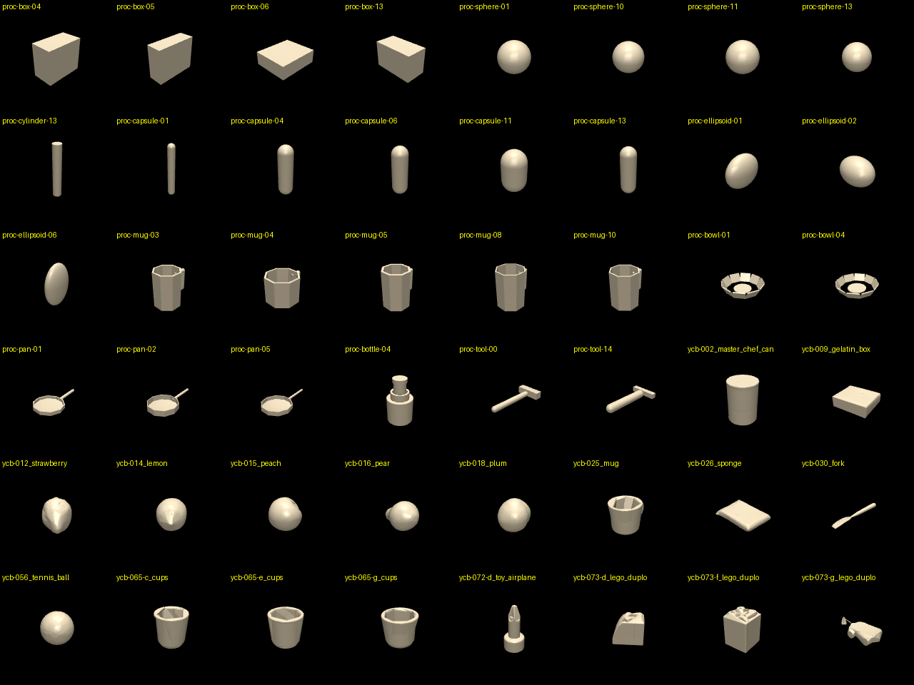

# Object library objects-v1

Generated by `scripts/build_objects.py` (git ``).

## Summary

| tier | objects | excluded | train | test_instance | test_category | parts median / max |
|---|---|---|---|---|---|---|
| procedural | 150 | 0 | 104 | 16 | 30 | 1 / 12 |
| ycb | 78 | 4 | 50 | 10 | 14 | 16 / 16 |

Held-out categories: mug (procedural), pan (procedural), bottle (ycb), tool (ycb)

## Contact counts

Protocol: 16 worlds per object x hand (leap_right, g1_dex3_1_right), descend over the object, close, lift 10 cm, hold. Capacity nconmax 200 / njmax 1500 per world.

- Peak contacts per world: median 26, max 78
- Peak constraint rows per world: median 94, max 298
- **Capacity overflow: 0 worlds** across 448 runs
- Lifted (object rose > 5 cm, open-loop top grasp): 16% of worlds

## Objects

| id | category | split | parts | extents (cm) | decomp. error p99 / mean (mm) | peak contacts / rows | lifted |
|---|---|---|---|---|---|---|---|
| proc-bottle-00 | bottle | train | 4 | 7.1 x 7.1 x 13.3 | exact | 24/71, 10/34 | 0%, 0% |
| proc-bottle-01 | bottle | train | 4 | 6.6 x 6.6 x 13.8 | exact | 24/70, 12/47 | 0%, 44% |
| proc-bottle-02 | bottle | test_instance | 4 | 6.4 x 6.4 x 13.1 | exact | 24/67, 12/49 | 0%, 44% |
| proc-bottle-03 | bottle | train | 4 | 6.7 x 6.7 x 12.5 | exact | 24/68, 11/42 | 0%, 0% |
| proc-bottle-04 | bottle | train | 4 | 7.1 x 7.1 x 12.2 | exact | 25/70, 15/55 | 0%, 62% |
| proc-bottle-05 | bottle | train | 4 | 7.0 x 7.0 x 9.9 | exact | 24/67, 11/42 | 0%, 75% |
| proc-bottle-06 | bottle | train | 4 | 4.9 x 4.9 x 10.7 | exact | 23/63, 13/47 | 0%, 19% |
| proc-bottle-07 | bottle | train | 4 | 5.7 x 5.7 x 13.7 | exact | 24/70, 10/42 | 0%, 0% |
| proc-bottle-08 | bottle | train | 4 | 6.8 x 6.8 x 13.2 | exact | 24/70, 15/61 | 0%, 69% |
| proc-bottle-09 | bottle | train | 4 | 5.8 x 5.8 x 12.1 | exact | 24/65, 14/57 | 0%, 38% |
| proc-bottle-10 | bottle | test_instance | 4 | 4.8 x 4.8 x 14.1 | exact | 22/62, 10/41 | 0%, 19% |
| proc-bottle-11 | bottle | train | 4 | 6.4 x 6.4 x 13.3 | exact | 24/70, 10/47 | 0%, 19% |
| proc-bottle-12 | bottle | train | 4 | 7.9 x 7.9 x 11.4 | exact | 24/67, 11/39 | 0%, 19% |
| proc-bottle-13 | bottle | train | 4 | 5.6 x 5.6 x 11.2 | exact | 24/67, 17/63 | 0%, 56% |
| proc-bottle-14 | bottle | train | 4 | 5.1 x 5.1 x 11.2 | exact | 24/65, 12/49 | 0%, 19% |
| proc-bowl-00 | bowl | train | 11 | 15.7 x 16.1 x 3.2 | exact | 40/138, 42/162 | 0%, 6% |
| proc-bowl-01 | bowl | train | 11 | 19.1 x 19.6 x 4.1 | exact | 39/138, 40/149 | 6%, 6% |
| proc-bowl-02 | bowl | test_instance | 11 | 14.5 x 14.9 x 3.4 | exact | 40/162, 41/162 | 6%, 50% |
| proc-bowl-03 | bowl | train | 11 | 19.9 x 20.4 x 4.0 | exact | 55/202, 43/174 | 6%, 0% |
| proc-bowl-04 | bowl | train | 11 | 16.4 x 16.9 x 3.0 | exact | 43/160, 41/168 | 0%, 12% |
| proc-bowl-05 | bowl | train | 11 | 15.3 x 15.5 x 4.6 | exact | 39/138, 40/149 | 6%, 56% |
| proc-bowl-06 | bowl | train | 11 | 19.9 x 20.4 x 4.6 | exact | 39/148, 37/137 | 0%, 25% |
| proc-bowl-07 | bowl | train | 11 | 16.6 x 17.1 x 3.5 | exact | 39/157, 42/170 | 0%, 25% |
| proc-bowl-08 | bowl | train | 11 | 18.2 x 18.8 x 3.1 | exact | 57/210, 43/170 | 6%, 12% |
| proc-bowl-09 | bowl | train | 11 | 14.8 x 15.2 x 3.5 | exact | 48/174, 47/187 | 6%, 6% |
| proc-bowl-10 | bowl | train | 11 | 15.1 x 15.4 x 4.1 | exact | 47/168, 39/159 | 0%, 50% |
| proc-bowl-11 | bowl | test_instance | 11 | 14.8 x 15.1 x 3.4 | exact | 41/138, 41/154 | 6%, 12% |
| proc-bowl-12 | bowl | train | 11 | 13.2 x 13.6 x 2.8 | exact | 55/207, 37/150 | 6%, 31% |
| proc-bowl-13 | bowl | train | 11 | 15.6 x 15.9 x 4.6 | exact | 39/166, 38/154 | 6%, 50% |
| proc-bowl-14 | bowl | train | 11 | 15.7 x 16.0 x 3.8 | exact | 47/175, 44/174 | 6%, 38% |
| proc-box-00 | box | train | 1 | 7.1 x 4.2 x 2.3 | exact | 23/66, 11/46 | 0%, 0% |
| proc-box-01 | box | train | 1 | 5.6 x 5.1 x 6.6 | exact | 23/66, 17/62 | 0%, 62% |
| proc-box-02 | box | test_instance | 1 | 7.0 x 5.4 x 7.7 | exact | 23/69, 20/82 | 0%, 94% |
| proc-box-03 | box | train | 1 | 8.1 x 5.5 x 5.3 | exact | 23/66, 16/66 | 0%, 50% |
| proc-box-04 | box | train | 1 | 9.9 x 5.6 x 8.6 | exact | 23/72, 22/94 | 0%, 81% |
| proc-box-05 | box | train | 1 | 9.7 x 3.6 x 8.0 | exact | 25/66, 21/86 | 0%, 81% |
| proc-box-06 | box | train | 1 | 7.3 x 6.3 x 2.4 | exact | 22/66, 11/47 | 0%, 0% |
| proc-box-07 | box | train | 1 | 3.0 x 7.0 x 8.6 | exact | 23/66, 17/75 | 0%, 88% |
| proc-box-08 | box | train | 1 | 3.1 x 5.6 x 5.4 | exact | 23/68, 13/59 | 0%, 12% |
| proc-box-09 | box | train | 1 | 8.9 x 3.6 x 7.5 | exact | 23/72, 19/82 | 0%, 81% |
| proc-box-10 | box | train | 1 | 5.6 x 7.2 x 4.8 | exact | 23/69, 17/64 | 0%, 12% |
| proc-box-11 | box | train | 1 | 7.3 x 4.3 x 3.0 | exact | 23/66, 11/47 | 0%, 0% |
| proc-box-12 | box | test_instance | 1 | 8.4 x 9.8 x 8.1 | exact | 23/75, 25/106 | 0%, 94% |
| proc-box-13 | box | train | 1 | 3.0 x 5.8 x 3.7 | exact | 23/66, 12/51 | 0%, 6% |
| proc-box-14 | box | train | 1 | 5.6 x 9.6 x 7.3 | exact | 24/66, 19/83 | 0%, 94% |
| proc-capsule-00 | capsule | train | 1 | 6.4 x 6.4 x 18.7 | exact | 24/59, 10/26 | 0%, 69% |
| proc-capsule-01 | capsule | train | 1 | 1.8 x 1.8 x 13.4 | exact | 20/58, 10/26 | 0%, 0% |
| proc-capsule-02 | capsule | train | 1 | 6.6 x 6.6 x 10.5 | exact | 21/58, 10/27 | 0%, 75% |
| proc-capsule-03 | capsule | train | 1 | 1.8 x 1.8 x 6.9 | exact | 19/54, 8/27 | 0%, 0% |
| proc-capsule-04 | capsule | train | 1 | 3.9 x 3.9 x 13.9 | exact | 21/58, 10/29 | 0%, 6% |
| proc-capsule-05 | capsule | train | 1 | 3.5 x 3.5 x 8.1 | exact | 20/58, 12/37 | 0%, 6% |
| proc-capsule-06 | capsule | test_instance | 1 | 3.0 x 3.0 x 9.6 | exact | 20/58, 12/37 | 0%, 31% |
| proc-capsule-07 | capsule | train | 1 | 5.8 x 5.8 x 16.6 | exact | 21/58, 10/26 | 0%, 44% |
| proc-capsule-08 | capsule | train | 1 | 5.4 x 5.4 x 15.3 | exact | 21/58, 10/26 | 0%, 25% |
| proc-capsule-09 | capsule | train | 1 | 3.4 x 3.4 x 14.6 | exact | 21/58, 12/37 | 0%, 6% |
| proc-capsule-10 | capsule | train | 1 | 5.8 x 5.8 x 9.0 | exact | 20/58, 9/34 | 0%, 31% |
| proc-capsule-11 | capsule | train | 1 | 6.1 x 6.1 x 10.5 | exact | 20/58, 9/30 | 0%, 56% |
| proc-capsule-12 | capsule | test_instance | 1 | 3.7 x 3.7 x 17.4 | exact | 21/58, 12/38 | 0%, 6% |
| proc-capsule-13 | capsule | train | 1 | 2.3 x 2.3 x 7.3 | exact | 20/58, 8/30 | 0%, 0% |
| proc-capsule-14 | capsule | train | 1 | 4.1 x 4.1 x 8.6 | exact | 20/58, 10/33 | 0%, 6% |
| proc-cylinder-00 | cylinder | train | 1 | 2.6 x 2.6 x 7.6 | exact | 21/62, 11/47 | 0%, 0% |
| proc-cylinder-01 | cylinder | train | 1 | 5.6 x 5.6 x 13.6 | exact | 24/63, 11/46 | 0%, 62% |
| proc-cylinder-02 | cylinder | train | 1 | 2.4 x 2.4 x 3.0 | exact | 21/62, 8/35 | 0%, 0% |
| proc-cylinder-03 | cylinder | train | 1 | 5.7 x 5.7 x 6.9 | exact | 22/62, 14/51 | 0%, 19% |
| proc-cylinder-04 | cylinder | train | 1 | 7.4 x 7.4 x 11.3 | exact | 28/77, 12/54 | 0%, 88% |
| proc-cylinder-05 | cylinder | train | 1 | 7.6 x 7.6 x 14.1 | exact | 25/91, 14/62 | 0%, 88% |
| proc-cylinder-06 | cylinder | train | 1 | 2.5 x 2.5 x 8.8 | exact | 22/63, 10/42 | 0%, 6% |
| proc-cylinder-07 | cylinder | test_instance | 1 | 7.1 x 7.1 x 13.2 | exact | 25/83, 11/50 | 0%, 88% |
| proc-cylinder-08 | cylinder | train | 1 | 5.8 x 5.8 x 10.3 | exact | 24/62, 15/54 | 0%, 62% |
| proc-cylinder-09 | cylinder | train | 1 | 4.3 x 4.3 x 12.9 | exact | 21/63, 12/46 | 0%, 69% |
| proc-cylinder-10 | cylinder | test_instance | 1 | 2.3 x 2.3 x 6.7 | exact | 21/62, 10/42 | 0%, 0% |
| proc-cylinder-11 | cylinder | train | 1 | 6.4 x 6.4 x 12.9 | exact | 24/71, 13/50 | 0%, 69% |
| proc-cylinder-12 | cylinder | train | 1 | 8.5 x 8.5 x 14.0 | exact | 30/97, 14/62 | 0%, 94% |
| proc-cylinder-13 | cylinder | train | 1 | 2.4 x 2.4 x 14.6 | exact | 22/62, 10/38 | 0%, 0% |
| proc-cylinder-14 | cylinder | train | 1 | 8.9 x 8.9 x 9.9 | exact | 23/79, 14/62 | 0%, 94% |
| proc-ellipsoid-00 | ellipsoid | train | 1 | 9.1 x 4.1 x 5.5 | exact | 20/54, 9/34 | 0%, 0% |
| proc-ellipsoid-01 | ellipsoid | train | 1 | 10.0 x 5.2 x 8.8 | exact | 21/55, 9/38 | 0%, 50% |
| proc-ellipsoid-02 | ellipsoid | train | 1 | 6.7 x 9.3 x 6.9 | exact | 20/54, 11/42 | 0%, 6% |
| proc-ellipsoid-03 | ellipsoid | train | 1 | 5.3 x 8.2 x 8.3 | exact | 20/54, 9/35 | 0%, 38% |
| proc-ellipsoid-04 | ellipsoid | train | 1 | 8.2 x 9.7 x 7.7 | exact | 21/55, 12/46 | 0%, 69% |
| proc-ellipsoid-05 | ellipsoid | test_instance | 1 | 2.8 x 6.6 x 2.6 | exact | 19/54, 7/27 | 0%, 0% |
| proc-ellipsoid-06 | ellipsoid | train | 1 | 5.9 x 2.6 x 8.9 | exact | 19/54, 11/33 | 0%, 19% |
| proc-ellipsoid-07 | ellipsoid | train | 1 | 8.1 x 2.9 x 9.2 | exact | 20/54, 10/31 | 0%, 25% |
| proc-ellipsoid-08 | ellipsoid | train | 1 | 4.4 x 4.3 x 6.1 | exact | 19/54, 8/27 | 0%, 0% |
| proc-ellipsoid-09 | ellipsoid | train | 1 | 7.0 x 2.8 x 3.7 | exact | 20/54, 7/27 | 0%, 0% |
| proc-ellipsoid-10 | ellipsoid | train | 1 | 6.5 x 8.5 x 3.5 | exact | 20/54, 9/31 | 0%, 0% |
| proc-ellipsoid-11 | ellipsoid | test_instance | 1 | 3.7 x 4.7 x 6.3 | exact | 19/54, 9/31 | 0%, 0% |
| proc-ellipsoid-12 | ellipsoid | train | 1 | 6.3 x 9.3 x 3.7 | exact | 20/54, 8/31 | 0%, 0% |
| proc-ellipsoid-13 | ellipsoid | train | 1 | 8.4 x 2.9 x 6.3 | exact | 20/54, 7/31 | 0%, 0% |
| proc-ellipsoid-14 | ellipsoid | train | 1 | 7.8 x 7.1 x 7.5 | exact | 20/54, 10/38 | 0%, 12% |
| proc-mug-00 | mug | test_category | 12 | 9.3 x 7.2 x 8.7 | exact | 53/197, 45/186 | 0%, 100% |
| proc-mug-01 | mug | test_category | 12 | 9.5 x 7.2 x 10.7 | exact | 55/205, 47/194 | 0%, 88% |
| proc-mug-02 | mug | test_category | 12 | 9.7 x 6.6 x 8.3 | exact | 53/202, 43/175 | 0%, 94% |
| proc-mug-03 | mug | test_category | 12 | 9.2 x 6.4 x 9.0 | exact | 53/206, 45/182 | 0%, 94% |
| proc-mug-04 | mug | test_category | 12 | 10.6 x 8.3 x 6.7 | exact | 54/196, 48/195 | 0%, 88% |
| proc-mug-05 | mug | test_category | 12 | 9.1 x 6.6 x 9.6 | exact | 53/206, 46/190 | 0%, 94% |
| proc-mug-06 | mug | test_category | 12 | 9.2 x 6.5 x 7.7 | exact | 53/211, 42/174 | 0%, 94% |
| proc-mug-07 | mug | test_category | 12 | 10.5 x 7.6 x 7.8 | exact | 53/190, 42/176 | 0%, 94% |
| proc-mug-08 | mug | test_category | 12 | 10.1 x 7.5 x 10.7 | exact | 56/213, 46/190 | 6%, 94% |
| proc-mug-09 | mug | test_category | 12 | 10.5 x 7.6 x 10.8 | exact | 56/190, 43/178 | 6%, 88% |
| proc-mug-10 | mug | test_category | 12 | 9.1 x 6.6 x 8.9 | exact | 53/206, 44/178 | 0%, 94% |
| proc-mug-11 | mug | test_category | 12 | 9.2 x 7.1 x 7.7 | exact | 53/196, 41/172 | 0%, 94% |
| proc-mug-12 | mug | test_category | 12 | 9.6 x 7.3 x 10.5 | exact | 55/198, 45/186 | 6%, 94% |
| proc-mug-13 | mug | test_category | 12 | 8.5 x 6.3 x 10.4 | exact | 53/213, 44/182 | 6%, 94% |
| proc-mug-14 | mug | test_category | 12 | 10.2 x 7.2 x 8.7 | exact | 53/197, 42/176 | 0%, 88% |
| proc-pan-00 | pan | test_category | 12 | 29.2 x 15.2 x 4.9 | exact | 62/228, 56/231 | 0%, 44% |
| proc-pan-01 | pan | test_category | 12 | 27.6 x 16.5 x 3.3 | exact | 59/207, 56/227 | 0%, 6% |
| proc-pan-02 | pan | test_category | 12 | 35.1 x 20.8 x 5.1 | exact | 62/222, 60/243 | 12%, 25% |
| proc-pan-03 | pan | test_category | 12 | 34.5 x 24.0 x 4.5 | exact | 61/232, 56/227 | 0%, 0% |
| proc-pan-04 | pan | test_category | 12 | 30.7 x 18.8 x 4.7 | exact | 62/230, 55/227 | 0%, 25% |
| proc-pan-05 | pan | test_category | 12 | 39.2 x 22.6 x 4.8 | exact | 62/223, 56/231 | 0%, 6% |
| proc-pan-06 | pan | test_category | 12 | 34.4 x 16.6 x 4.8 | exact | 62/226, 58/235 | 0%, 6% |
| proc-pan-07 | pan | test_category | 12 | 32.2 x 17.4 x 4.8 | exact | 62/241, 62/251 | 0%, 19% |
| proc-pan-08 | pan | test_category | 12 | 31.5 x 18.6 x 4.2 | exact | 45/165, 37/147 | 0%, 6% |
| proc-pan-09 | pan | test_category | 12 | 31.2 x 17.2 x 4.2 | exact | 62/222, 59/239 | 0%, 12% |
| proc-pan-10 | pan | test_category | 12 | 35.3 x 19.2 x 4.4 | exact | 62/226, 59/239 | 0%, 6% |
| proc-pan-11 | pan | test_category | 12 | 32.2 x 19.0 x 4.6 | exact | 62/223, 56/227 | 0%, 38% |
| proc-pan-12 | pan | test_category | 12 | 35.0 x 22.0 x 3.6 | exact | 62/236, 55/223 | 0%, 6% |
| proc-pan-13 | pan | test_category | 12 | 33.8 x 21.2 x 4.3 | exact | 62/226, 56/230 | 0%, 12% |
| proc-pan-14 | pan | test_category | 12 | 27.8 x 14.8 x 4.2 | exact | 62/227, 56/227 | 0%, 12% |
| proc-sphere-00 | sphere | train | 1 | 8.2 x 8.3 x 8.3 | exact | 20/54, 8/35 | 0%, 75% |
| proc-sphere-01 | sphere | train | 1 | 8.0 x 8.0 x 8.0 | exact | 20/54, 10/38 | 0%, 62% |
| proc-sphere-02 | sphere | train | 1 | 8.2 x 8.2 x 8.2 | exact | 20/54, 8/35 | 0%, 69% |
| proc-sphere-03 | sphere | test_instance | 1 | 8.3 x 8.3 x 8.3 | exact | 20/54, 8/35 | 0%, 69% |
| proc-sphere-04 | sphere | train | 1 | 3.9 x 3.9 x 3.9 | exact | 19/54, 7/27 | 0%, 0% |
| proc-sphere-05 | sphere | train | 1 | 4.9 x 4.9 x 4.9 | exact | 20/54, 7/27 | 0%, 0% |
| proc-sphere-06 | sphere | train | 1 | 3.7 x 3.7 x 3.7 | exact | 19/54, 7/27 | 0%, 0% |
| proc-sphere-07 | sphere | test_instance | 1 | 5.5 x 5.5 x 5.5 | exact | 20/54, 7/27 | 0%, 0% |
| proc-sphere-08 | sphere | train | 1 | 7.3 x 7.3 x 7.3 | exact | 20/54, 10/38 | 0%, 0% |
| proc-sphere-09 | sphere | train | 1 | 6.4 x 6.5 x 6.5 | exact | 20/54, 9/31 | 0%, 0% |
| proc-sphere-10 | sphere | train | 1 | 4.0 x 4.0 x 4.0 | exact | 19/54, 7/27 | 0%, 0% |
| proc-sphere-11 | sphere | train | 1 | 8.1 x 8.1 x 8.1 | exact | 20/54, 10/38 | 0%, 69% |
| proc-sphere-12 | sphere | train | 1 | 3.0 x 3.1 x 3.0 | exact | 19/54, 7/27 | 0%, 0% |
| proc-sphere-13 | sphere | train | 1 | 2.5 x 2.5 x 2.5 | exact | 19/54, 7/27 | 0%, 0% |
| proc-sphere-14 | sphere | train | 1 | 6.5 x 6.5 x 6.5 | exact | 20/54, 9/31 | 0%, 0% |
| proc-tool-00 | tool | train | 2 | 26.1 x 12.0 x 3.5 | exact | 22/65, 15/59 | 0%, 0% |
| proc-tool-01 | tool | train | 2 | 17.3 x 10.5 x 2.7 | exact | 22/71, 15/63 | 0%, 0% |
| proc-tool-02 | tool | test_instance | 2 | 34.8 x 6.5 x 3.5 | exact | 25/75, 15/55 | 0%, 38% |
| proc-tool-03 | tool | train | 6 | 23.1 x 7.8 x 2.4 | exact | 23/72, 15/58 | 0%, 0% |
| proc-tool-04 | tool | train | 2 | 22.5 x 10.7 x 3.5 | exact | 22/65, 13/51 | 0%, 6% |
| proc-tool-05 | tool | train | 7 | 24.7 x 7.5 x 2.7 | exact | 24/74, 17/73 | 0%, 0% |
| proc-tool-06 | tool | train | 2 | 21.3 x 5.5 x 1.8 | exact | 21/68, 12/51 | 0%, 0% |
| proc-tool-07 | tool | train | 5 | 19.6 x 10.1 x 2.5 | exact | 24/81, 14/59 | 0%, 0% |
| proc-tool-08 | tool | train | 2 | 24.0 x 4.5 x 3.0 | exact | 22/66, 16/54 | 0%, 12% |
| proc-tool-09 | tool | test_instance | 2 | 24.7 x 7.3 x 3.2 | exact | 21/63, 17/76 | 0%, 6% |
| proc-tool-10 | tool | train | 7 | 22.8 x 6.8 x 3.1 | exact | 23/74, 14/63 | 0%, 0% |
| proc-tool-11 | tool | train | 2 | 21.2 x 9.3 x 3.5 | exact | 22/65, 15/58 | 0%, 6% |
| proc-tool-12 | tool | train | 5 | 16.8 x 8.7 x 1.8 | exact | 23/104, 14/55 | 0%, 0% |
| proc-tool-13 | tool | train | 7 | 18.2 x 8.4 x 2.7 | exact | 27/90, 17/63 | 0%, 6% |
| proc-tool-14 | tool | train | 2 | 21.6 x 11.1 x 3.4 | exact | 23/66, 14/56 | 0%, 12% |
| ycb-053_mini_soccer_ball | ball | excluded: too_large_single_hand | 7 | 12.8 x 12.8 x 12.6 | 2.0 / 0.7 | - | - |
| ycb-054_softball | ball | train | 4 | 9.5 x 9.6 x 9.5 | 1.5 / 0.6 | 32/93, 30/126 | 0%, 100% |
| ycb-055_baseball | ball | train | 2 | 7.3 x 7.4 x 7.3 | 1.1 / 0.5 | 26/84, 25/106 | 0%, 56% |
| ycb-056_tennis_ball | ball | test_instance | 3 | 6.7 x 6.7 x 6.6 | 1.2 / 0.4 | 23/71, 34/143 | 0%, 12% |
| ycb-057_racquetball | ball | train | 1 | 5.6 x 5.6 x 5.6 | 0.9 / 0.5 | 23/68, 14/62 | 0%, 0% |
| ycb-058_golf_ball | ball | train | 1 | 4.3 x 4.3 x 4.2 | 0.7 / 0.3 | 22/66, 12/51 | 0%, 0% |
| ycb-063-a_marbles | ball | train | 16 | 8.7 x 7.7 x 7.2 | 6.2 / 1.4 | 24/109, 32/117 | 0%, 0% |
| ycb-063-b_marbles | ball | train | 4 | 3.5 x 3.5 x 3.4 | 1.1 / 0.2 | 26/82, 22/91 | 0%, 0% |
| ycb-036_wood_block | block | train | 2 | 10.4 x 10.3 x 20.6 | 2.5 / 1.0 | 27/97, 31/131 | 0%, 75% |
| ycb-059_chain | block | train | 16 | 31.0 x 30.7 x 2.5 | 11.1 / 4.3 | 78/298, 70/273 | 0%, 0% |
| ycb-061_foam_brick | block | train | 16 | 5.3 x 7.8 x 5.1 | 8.4 / 0.7 | 46/196, 51/207 | 0%, 12% |
| ycb-062_dice | block | train | 15 | 1.7 x 1.7 x 1.8 | 1.1 / 0.2 | 37/126, 48/181 | 0%, 0% |
| ycb-065-a_cups | block | train | 16 | 5.7 x 5.7 x 6.2 | 5.5 / 1.5 | 34/158, 48/198 | 0%, 12% |
| ycb-065-b_cups | block | train | 16 | 6.1 x 6.1 x 6.4 | 5.6 / 1.4 | 33/130, 43/175 | 0%, 19% |
| ycb-065-c_cups | block | train | 16 | 6.5 x 6.5 x 6.7 | 6.1 / 1.6 | 34/141, 36/147 | 0%, 56% |
| ycb-065-d_cups | block | train | 16 | 7.1 x 7.1 x 6.9 | 5.5 / 1.8 | 33/145, 36/147 | 0%, 62% |
| ycb-065-e_cups | block | train | 16 | 7.6 x 7.5 x 7.1 | 6.1 / 1.8 | 38/182, 41/170 | 0%, 75% |
| ycb-065-f_cups | block | train | 16 | 8.1 x 8.1 x 7.2 | 6.6 / 1.8 | 34/159, 47/194 | 0%, 81% |
| ycb-065-g_cups | block | train | 16 | 8.7 x 8.8 x 7.4 | 6.3 / 1.8 | 59/233, 55/226 | 0%, 88% |
| ycb-065-h_cups | block | train | 16 | 9.1 x 9.2 x 7.5 | 6.2 / 1.5 | 34/142, 47/195 | 0%, 88% |
| ycb-065-i_cups | block | train | 16 | 9.8 x 9.8 x 7.6 | 7.4 / 2.1 | 36/122, 47/194 | 0%, 88% |
| ycb-065-j_cups | block | train | 16 | 10.2 x 10.3 x 7.5 | 6.2 / 1.7 | 48/190, 56/230 | 6%, 88% |
| ycb-070-a_colored_wood_blocks | block | excluded: too_large_single_hand | 16 | 14.2 x 14.1 x 16.5 | 12.4 / 2.7 | - | - |
| ycb-070-b_colored_wood_blocks | block | train | 8 | 3.5 x 3.5 x 2.6 | 1.6 / 0.3 | 38/130, 30/123 | 0%, 0% |
| ycb-071_nine_hole_peg_test | block | train | 16 | 16.8 x 19.1 x 4.1 | 9.2 / 0.8 | 43/150, 44/179 | 0%, 44% |
| ycb-072-a_toy_airplane | block | excluded: too_large_single_hand | 16 | 25.5 x 26.3 x 18.3 | 13.8 / 3.2 | - | - |
| ycb-072-b_toy_airplane | block | test_instance | 16 | 12.0 x 18.2 x 5.9 | 3.6 / 0.8 | 41/158, 49/185 | 0%, 50% |
| ycb-072-c_toy_airplane | block | train | 16 | 3.1 x 3.1 x 6.7 | 4.0 / 0.9 | 34/114, 32/130 | 0%, 0% |
| ycb-072-d_toy_airplane | block | train | 16 | 3.1 x 3.1 x 6.6 | 3.8 / 0.6 | 46/162, 38/147 | 0%, 0% |
| ycb-072-e_toy_airplane | block | test_instance | 16 | 3.1 x 3.1 x 6.6 | 4.0 / 0.5 | 50/178, 43/175 | 0%, 0% |
| ycb-073-a_lego_duplo | block | train | 16 | 6.4 x 3.3 x 2.4 | 4.5 / 1.2 | 26/121, 42/157 | 0%, 0% |
| ycb-073-b_lego_duplo | block | train | 16 | 3.7 x 3.7 x 4.3 | 3.6 / 0.8 | 37/123, 33/122 | 0%, 0% |
| ycb-073-c_lego_duplo | block | train | 16 | 3.4 x 6.5 x 2.4 | 6.0 / 1.4 | 30/100, 50/189 | 0%, 0% |
| ycb-073-d_lego_duplo | block | train | 16 | 5.4 x 5.6 x 4.3 | 5.7 / 1.0 | 43/139, 43/166 | 0%, 0% |
| ycb-073-e_lego_duplo | block | train | 16 | 6.9 x 10.0 x 4.3 | 10.1 / 1.4 | 41/174, 53/201 | 0%, 0% |
| ycb-073-f_lego_duplo | block | test_instance | 16 | 3.7 x 3.7 x 4.3 | 3.5 / 0.8 | 34/104, 38/155 | 0%, 0% |
| ycb-073-g_lego_duplo | block | test_instance | 16 | 13.4 x 30.4 x 6.0 | 11.2 / 3.1 | 41/156, 36/151 | 0%, 81% |
| ycb-077_rubiks_cube | block | train | 16 | 7.6 x 7.6 x 5.8 | 3.1 / 0.5 | 58/199, 46/182 | 0%, 19% |
| ycb-006_mustard_bottle | bottle | test_category | 6 | 9.7 x 6.7 x 19.1 | 2.9 / 0.8 | 27/98, 26/93 | 6%, 25% |
| ycb-021_bleach_cleanser | bottle | test_category | 5 | 10.2 x 6.8 x 25.1 | 2.8 / 0.9 | 29/103, 26/93 | 0%, 44% |
| ycb-022_windex_bottle | bottle | test_category | 16 | 8.3 x 9.5 x 27.0 | 4.3 / 1.1 | 52/199, 38/158 | 0%, 44% |
| ycb-002_master_chef_can | can | train | 16 | 10.3 x 10.2 x 14.0 | 3.6 / 1.6 | 45/174, 37/155 | 0%, 100% |
| ycb-005_tomato_soup_can | can | test_instance | 16 | 6.8 x 6.8 x 10.2 | 6.0 / 1.2 | 47/177, 42/174 | 0%, 88% |
| ycb-007_tuna_fish_can | can | train | 16 | 8.6 x 8.6 x 3.4 | 3.2 / 0.9 | 62/223, 59/239 | 0%, 0% |
| ycb-010_potted_meat_can | can | train | 16 | 10.2 x 6.0 x 8.4 | 3.7 / 0.9 | 41/155, 46/191 | 0%, 81% |
| ycb-030_fork | cutlery | train | 3 | 19.8 x 2.7 x 1.6 | 3.4 / 0.8 | 26/100, 20/82 | 0%, 0% |
| ycb-031_spoon | cutlery | train | 6 | 18.6 x 8.3 x 2.1 | 2.9 / 0.8 | 27/84, 31/129 | 0%, 0% |
| ycb-032_knife | cutlery | test_instance | 3 | 21.5 x 2.1 x 2.3 | 2.5 / 0.7 | 29/98, 19/81 | 0%, 0% |
| ycb-033_spatula | cutlery | train | 9 | 30.6 x 12.5 x 3.3 | 3.8 / 1.0 | 30/121, 27/113 | 0%, 12% |
| ycb-003_cracker_box | food_box | train | 5 | 7.2 x 16.4 x 21.3 | 3.0 / 1.1 | 37/130, 31/130 | 0%, 69% |
| ycb-004_sugar_box | food_box | train | 2 | 4.9 x 9.4 x 17.6 | 2.1 / 0.8 | 27/94, 27/114 | 0%, 88% |
| ycb-008_pudding_box | food_box | train | 3 | 13.8 x 12.9 x 3.9 | 1.7 / 0.6 | 32/98, 23/95 | 0%, 25% |
| ycb-009_gelatin_box | food_box | test_instance | 4 | 8.9 x 10.1 x 3.0 | 1.4 / 0.5 | 33/125, 28/115 | 0%, 0% |
| ycb-011_banana | fruit | train | 4 | 10.9 x 17.8 x 3.7 | 3.0 / 0.7 | 32/133, 32/131 | 0%, 6% |
| ycb-012_strawberry | fruit | train | 16 | 4.5 x 4.5 x 4.6 | 1.6 / 0.4 | 29/110, 47/191 | 0%, 0% |
| ycb-013_apple | fruit | train | 16 | 7.5 x 7.5 x 7.2 | 1.3 / 0.5 | 40/188, 44/179 | 0%, 75% |
| ycb-014_lemon | fruit | train | 3 | 6.1 x 5.9 x 5.3 | 1.4 / 0.4 | 25/87, 21/90 | 0%, 0% |
| ycb-015_peach | fruit | train | 16 | 6.2 x 6.3 x 5.9 | 1.7 / 0.4 | 32/118, 37/154 | 0%, 0% |
| ycb-016_pear | fruit | train | 5 | 6.7 x 10.0 x 6.6 | 1.8 / 0.5 | 27/103, 26/103 | 0%, 12% |
| ycb-017_orange | fruit | train | 7 | 7.2 x 7.4 x 7.1 | 1.2 / 0.4 | 29/134, 41/166 | 0%, 50% |
| ycb-018_plum | fruit | test_instance | 12 | 5.7 x 5.5 x 5.3 | 3.2 / 0.4 | 39/138, 43/175 | 0%, 0% |
| ycb-019_pitcher_base | kitchenware | excluded: too_large_single_hand | 16 | 14.9 x 14.5 x 24.2 | 11.1 / 2.2 | - | - |
| ycb-024_bowl | kitchenware | train | 16 | 16.1 x 16.1 x 5.5 | 9.1 / 2.0 | 59/221, 39/164 | 0%, 88% |
| ycb-025_mug | kitchenware | train | 16 | 11.7 x 9.3 x 8.1 | 11.3 / 2.8 | 38/162, 48/199 | 0%, 100% |
| ycb-026_sponge | kitchenware | test_instance | 10 | 7.9 x 11.2 x 1.9 | 1.7 / 0.6 | 45/170, 38/141 | 0%, 0% |
| ycb-028_skillet_lid | kitchenware | train | 16 | 26.8 x 26.9 x 7.6 | 5.9 / 1.5 | 53/204, 58/238 | 6%, 100% |
| ycb-029_plate | kitchenware | train | 16 | 26.0 x 26.1 x 2.7 | 8.2 / 3.3 | 34/126, 43/166 | 0%, 0% |
| ycb-035_power_drill | tool | test_category | 16 | 18.4 x 18.8 x 5.7 | 5.5 / 1.0 | 44/173, 52/214 | 0%, 44% |
| ycb-037_scissors | tool | test_category | 16 | 9.6 x 20.2 x 1.6 | 3.9 / 0.7 | 69/258, 67/266 | 0%, 0% |
| ycb-038_padlock | tool | test_category | 16 | 6.7 x 6.8 x 2.9 | 4.6 / 0.6 | 56/209, 46/173 | 0%, 0% |
| ycb-040_large_marker | tool | test_category | 13 | 2.1 x 12.1 x 1.9 | 2.1 / 0.4 | 32/150, 33/120 | 0%, 0% |
| ycb-042_adjustable_wrench | tool | test_category | 12 | 12.5 x 18.1 x 1.5 | 4.6 / 1.6 | 29/139, 34/132 | 0%, 0% |
| ycb-043_phillips_screwdriver | tool | test_category | 8 | 19.5 x 10.7 x 3.6 | 4.2 / 0.6 | 35/168, 34/138 | 0%, 6% |
| ycb-044_flat_screwdriver | tool | test_category | 12 | 16.2 x 15.7 x 3.5 | 2.1 / 0.5 | 33/148, 37/151 | 0%, 0% |
| ycb-048_hammer | tool | test_category | 8 | 18.2 x 33.3 x 3.3 | 3.6 / 0.9 | 49/176, 36/135 | 0%, 6% |
| ycb-050_medium_clamp | tool | test_category | 16 | 8.9 x 7.7 x 2.6 | 3.8 / 1.0 | 26/131, 36/133 | 0%, 0% |
| ycb-051_large_clamp | tool | test_category | 16 | 12.0 x 17.1 x 3.9 | 7.9 / 2.7 | 31/114, 37/142 | 0%, 31% |
| ycb-052_extra_large_clamp | tool | test_category | 16 | 21.0 x 16.4 x 3.6 | 8.5 / 2.1 | 27/112, 32/132 | 0%, 19% |

